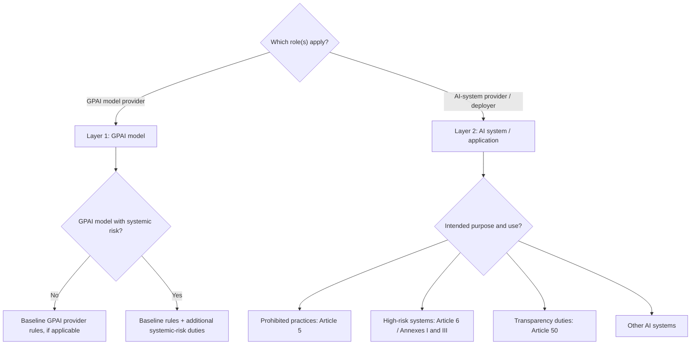

# EU AI Act Compliance for LLMs: Model Level vs. Application Level

A practical, developer-oriented guide to the **two regulatory layers** of the European Union Artificial Intelligence Act (**EU AI Act**) for open-weight LLMs, continued pre-training, hosted APIs, and downstream applications.

> **Scope and legal status:** Educational overview, not legal advice or a compliance certificate. This README reflects **Regulation (EU) 2024/1689 as amended by Regulation (EU) 2026/1744**, with a reference date of **15 November 2026**. Assess the exact applicable provisions, exceptions, transition dates, and other EU/national laws for each deployment.

## 1. Start with two distinct regulatory layers

First identify your role(s): **GPAI model provider**, **provider or deployer of an AI application based on a pretrained GPAI model**, or **both**. Follow both branches when both roles apply.

| | **Layer 1 — Model-level regulation** | **Layer 2 — Application-level regulation** |
| --- | --- | --- |
| **Regulated object** | General-purpose AI (**GPAI**) model | AI **system** built with or around a model |
| **Main question** | Who provides the GPAI model, and does it present **systemic risk**? | What does the AI system **do**, and how is it used? |
| **Main legal provisions** | Articles **51–56**, especially 53 and 55 | Articles **5**, **6**, **9–15**, **26**, **50**, and relevant annexes |
| **Examples** | Original LLM; materially modified model after continued pre-training | Chatbot; hiring screener; internal document classifier |
| **Tests/evidence** | Model documentation, capabilities, relevant evaluations; adversarial testing for systemic-risk GPAI providers | Use-case risk assessment; accuracy, fairness, robustness, oversight and logging where applicable |
| **Who may be responsible** | GPAI **model provider** | AI-system **provider** and/or **deployer** |

**These layers can apply simultaneously.** An organisation that provides its own GPAI model and an AI application built on it can have duties under both layers ([Recital 97](https://ai-act-service-desk.ec.europa.eu/en/ai-act/recital-97)). The same model may power multiple applications with different legal obligations, and the responsible model provider and application provider may be **different organisations**.

---

## 2. Layer 1 — GPAI Model Compliance

**Regulates the underlying general-purpose model**, not the specific purpose of each downstream application. A GPAI model provider may have obligations even before deciding whether a particular customer will use the model for recruitment, customer support, or another task.

### 2.1 Identify your role

| Situation | Likely implication |
| --- | --- |
| **Host** an existing third-party open-weight LLM unchanged using vLLM/Ollama | Usually does **not** make you the original GPAI model provider; still assess responsibilities for the AI service you offer. |
| **Fine-tune** an existing model with LoRA/SFT | Fine-tuning alone does **not** automatically make you a new GPAI model provider. Examine the modification, how the model is offered, and applicable guidance. |
| **Continue pre-training** with substantial additional data and compute | May make you the provider of a modified GPAI model; assess changes to capabilities, generality, systemic risk and compute. |
| **Develop** and place your own GPAI model on the EU market | GPAI model-provider rules generally apply, subject to scope and exemptions. |

The Commission's GPAI guidance discusses an **indicative one-third-of-original-training-compute criterion** for assessing when a model modification may create new GPAI provider responsibilities. It is **not** an automatic statutory threshold and is **different from** the systemic-risk compute threshold below.

### 2.2 Classify the GPAI model

| Classification | Basis | Regulatory consequence |
| --- | --- | --- |
| **GPAI without systemic risk** | A GPAI model not classified as presenting systemic risk | Applicable baseline **Article 53** duties for its provider |
| **GPAI with systemic risk** | High-impact capabilities under **Article 51**, or Commission designation based on equivalent capability/impact using **Annex XIII** criteria | Baseline GPAI obligations **plus Article 55** duties |

#### How is systemic risk assessed?

1. **Training-compute presumption — Article 51(2):** cumulative training computation **greater than `10^25` FLOPs** gives rise to the Act's presumption of high-impact capabilities. Applicable providers must follow the Article 52 notification procedure; the legislation permits a substantiated rebuttal in exceptional circumstances.
2. **Capabilities and impact — Article 51 / Annex XIII:** the European Commission can designate models based on capabilities or impact even if the compute threshold is not reached. Consider model parameters, data scale/quality, modalities, benchmarks, autonomy, tools, scalability, business reach and end-user reach.

**Neither a single successful jailbreak nor a model's parameter count alone is a legal finding of systemic risk.** Conversely, being below the compute threshold is not a universal exemption.

### 2.3 Model-provider legal obligations

| Obligation | GPAI without systemic risk | GPAI with systemic risk | Legal reference |
| --- | --- | --- | --- |
| Maintain technical documentation of model development/training/evaluation | Generally applicable* | Required | Article 53(1)(a), Annex XI |
| Give downstream AI-system providers relevant model information | Generally applicable* | Required | Article 53(1)(b), Annex XII |
| Implement an EU copyright-compliance policy | Required | Required | Article 53(1)(c) |
| Publish a sufficiently detailed training-content summary using the AI Office template | Required | Required | Article 53(1)(d) |
| Cooperate as necessary with the Commission and national competent authorities | Required | Required | Article 53(3) |
| Appoint an EU authorised representative before placing the model on the EU market | Required for non-EU providers* | Required for non-EU providers | Article 54(1), (6) |
| Conduct and document model evaluation, **including adversarial testing** | No universal Article 55 duty | **Required** | Article 55(1)(a) |
| Assess and mitigate systemic risks | No universal Article 55 duty | **Required** | Article 55(1)(b) |
| Track/document/report relevant serious incidents | No universal Article 55 duty | **Required** | Article 55(1)(c) |
| Provide adequate cybersecurity for model and physical infrastructure | No universal Article 55 duty | **Required** | Article 55(1)(d) |

\*The exemptions from the first two documentation duties and the EU-representative duty apply to GPAI models **without systemic risk** released under a **free and open-source licence allowing access, use, modification and distribution**, with **parameters (including weights), architecture information and usage information publicly available**. **Open weights alone are insufficient.** See [Article 53(2)](https://ai-act-service-desk.ec.europa.eu/en/ai-act/article-53) and [Article 54(6)](https://ai-act-service-desk.ec.europa.eu/en/ai-act/article-54).

These exemptions **do not cover the copyright-policy or training-summary obligations**. Providers of GPAI models **with systemic risk** cannot use these exemptions.

### 2.4 Model-level testing: legal requirement vs. engineering practice

| Test or review | Example | Status |
| --- | --- | --- |
| **Adversarial model testing** | Jailbreaks, GCG-style attacks, red teaming | **Explicitly required by Article 55** for GPAI providers with systemic-risk models; otherwise useful best practice |
| **Capability evaluation** | Reasoning, tool use, coding, autonomous-task benchmarks | Appropriate as needed to document capabilities and assess systemic risk; not one universal benchmark mandate |
| **Privacy leakage tests** | Regurgitation of memorised personal data | Recommended; data-protection duties may independently apply |
| **Bias and robustness tests** | Performance across groups, prompt variations | Recommended and context-dependent |
| **Training data and copyright audit** | Data provenance, rights reservations, personal data | Supports applicable copyright/GDPR obligations; runtime guardrails do not replace it |
| **Cybersecurity review** | Access controls, model theft risks, infrastructure attacks | Article 55 duty for systemic-risk GPAI providers; other cybersecurity laws may also apply |

> **Key point:** Article 55 requires adversarial testing for **GPAI models with systemic risk**; it does **not** prescribe GCG or any other single attack algorithm, and it does **not** make full red teaming mandatory for every ordinary open-weight model API.

---

## 3. Layer 2 — AI System / Application Compliance

**Regulates what the deployed AI system is intended to do and how it is used.** This assessment is separate from the model's GPAI status.

### 3.1 Four commonly used application-risk categories

| Category | Definition | Application examples | Main implication | Legal basis |
| --- | --- | --- | --- | --- |
| **1. Unacceptable risk** | Specific AI practices are prohibited when the statutory conditions are met | Harmful manipulative AI; prohibited social scoring; indiscriminate scraping for facial-recognition databases; prohibited emotion recognition at work/school | **Prohibited**, subject to precise conditions and exceptions | Article 5 |
| **2. High risk** | Certain safety-related products/components or specifically designated sensitive AI-system uses | Applicant ranking; educational assessments; certain credit assessments; safety components for critical infrastructure | Extensive **provider/deployer** requirements when applicable | Article 6, Annexes I/III; Articles 8–49 |
| **3. Transparency-related** | Certain interactions or synthetic outputs require disclosure or marking | Customer-support chatbot; deepfake media; specified AI-generated content | Inform users and/or mark/disclose AI-generated content as applicable | Article 50 |
| **4. Other AI systems** | Systems not caught by the above specific regimes | Spam filter; internal technical-document tagging; inventory forecasting | Generally fewer AI-Act-specific duties; other laws can still apply | General AI Act framework |

**Important:** These are convenient **explanatory groups, not four mutually exclusive statutory classifications**. A high-risk system can also owe Article 50 transparency duties. A model's licence or family name does not by itself determine the application category.

### 3.2 Illustrative scenarios using the same Qwen model

| Deployed application | Illustrative category | Reason |
| --- | --- | --- |
| Chatbot deliberately exploiting vulnerable users to cause significant financial harm | **Potentially unacceptable risk** | May satisfy an Article 5 prohibited-practice definition |
| Automated CV screening and candidate ranking | **Generally high risk** | Recruitment and selection uses appear in Annex III, subject to Article 6 conditions |
| Public customer-service chatbot | **Transparency-related** | Direct human–AI interaction triggers Article 50 duties where applicable |
| Internal API classifying engineering documents | **Often other/lower risk** | Not inherently a listed high-risk use case |

A **generic backend API** is not necessarily a stand-alone "transparency-risk category". Check how the entire AI system interacts with people and whether its output requires marking or disclosure.

### 3.3 Prohibited AI practices (Article 5)

Illustrative practices include:

- Harmful manipulative or deceptive techniques meeting the law's material-distortion and harm tests.
- Exploiting vulnerabilities connected to age, disability or specific social/economic circumstances under the legal conditions.
- Social scoring causing certain unjustified or unrelated detrimental treatment.
- Certain individual crime-risk assessments based **solely** on profiling or personality characteristics.
- Untargeted facial-image scraping to build or expand facial-recognition databases.
- Emotion recognition in workplaces or educational settings, subject to specified medical/safety exceptions.
- Certain sensitive biometric categorisation and public-space real-time biometric identification practices.

The **2026 amendment** adds specified prohibitions involving non-consensual intimate synthetic content and child sexual abuse material, taking effect **2 December 2026**, under their precise legal conditions. **A model's ability to produce a harmful answer is not, on its own, proof that a prohibited AI practice has occurred.**

### 3.4 High-risk AI-system obligations

Where a system is legally classified as **high risk**, assess the following provisions and corresponding evidence:

| Area | What to demonstrate | Legal reference |
| --- | --- | --- |
| Risk management | Ongoing risk identification, controls, verification and testing | Article 9 |
| Data governance | Appropriate training/validation/testing data practices where applicable | Article 10 |
| Technical documentation | System design, intended purpose, test results and compliance evidence | Article 11; Annex IV |
| Record keeping | Appropriate automatically generated logs and traceability | Article 12 |
| Transparency to deployers | Instructions, capabilities, limits and appropriate interpretation | Article 13 |
| Human oversight | Ability for suitable humans to supervise and intervene | Article 14 |
| Accuracy, robustness and cybersecurity | Appropriate tested levels across the system lifecycle | Article 15 |
| Provider obligations | Quality management, conformity assessment, registration where applicable, corrective actions | Articles 16–24, 43–49 |
| Deployer obligations | Proper use, monitoring, human oversight, applicable recordkeeping and notification | Article 26 |
| Fundamental-rights impact assessment | Required for **certain** deployments, not every high-risk system | Article 27 |
| Post-market monitoring and incidents | Applicable monitoring and serious-incident procedures | Articles 72–73 |

**Application-level test examples:** recruitment-selection accuracy; disparate-impact/bias tests; prompt-injection attempts in CVs; logs and traceability; human review/override tests; resilience to erroneous inputs; privacy leakage checks. These are **practical ways of supporting** statutory requirements, not an EU-mandated list of benchmark names.

### 3.5 Transparency-related obligations (Article 50)

Depending on the system and role, these may include:

- Notice that a person is interacting with AI unless obvious or exempt.
- Machine-readable marking of synthetic text, image, audio or video outputs, as technically required.
- Disclosure of deepfakes and certain AI-generated public-interest text, subject to exceptions.

A bare API field such as `ai_generated: true` should **not** be assumed to fulfil every Article 50 marking requirement.

### 3.6 Other AI systems

Lower-risk applications generally do **not** automatically inherit all high-risk AI-system requirements. Still assess Article 4 AI literacy, any applicable Article 50 requirements, **GDPR**, intellectual-property rules, cybersecurity and consumer protection laws. Basic red teaming, privacy controls and logging are often advisable even when not explicitly mandated by an AI Act provision.

---

## 4. Putting both layers together: LLM-as-a-Service checklist

Example: you host a **Qwen** model behind a public API, and downstream customers build applications on it.

### Model-level questions

- [ ] Identify the original GPAI model provider and the licence.
- [ ] Record model identifier, release/version, architecture and intended capabilities.
- [ ] Record when the model was first placed on the EU market and assess applicable transitions, including the **2 August 2027** compliance deadline for models placed on the market **before 2 August 2025** (Article 111(3)).
- [ ] Determine whether you **modified** the model; if so, record continued-pre-training/fine-tuning data and compute.
- [ ] Assess whether the modification makes you a GPAI model provider under applicable guidance.
- [ ] Assess potential **systemic-risk** classification (Article 51, Annex XIII) and applicable notification rules (Article 52).
- [ ] If you are the responsible GPAI provider, prepare applicable **Article 53** evidence, publish the training-content summary using the **AI Office template**, and assess open-source exemptions against the licence and public-information conditions in Section 2.3.
- [ ] If you are a GPAI provider established outside the EU, appoint an **EU authorised representative before placing the model on the EU market**, unless the Article 54(6) open-source exemption applies.
- [ ] If you are the responsible GPAI provider, arrange cooperation with the Commission and national competent authorities as necessary (Article 53(3)).
- [ ] If the model has systemic risk and you are its provider, implement **Article 55** evaluation, adversarial testing, risk mitigation, incident reporting and cybersecurity obligations.
- [ ] Review training-data **copyright** and **GDPR** implications when relevant.

### Application-level questions

- [ ] Identify the AI-system **provider** and **deployer**, and allocate responsibilities.
- [ ] Document permitted/intended uses, users, capabilities and foreseeable misuse.
- [ ] Check for **Article 5 prohibited practices**.
- [ ] Determine whether the intended application is **high risk** under Article 6 and Annexes I/III, including exceptions.
- [ ] Assess **Article 50 transparency and content-marking** duties.
- [ ] If high risk, implement the applicable **Articles 9–15** requirements, provider/deployer duties, conformity procedures and monitoring.
- [ ] Apply proportionate **prompt-injection/jailbreak**, privacy, security and misuse testing.
- [ ] Keep appropriate records of testing, risk decisions, controls, incidents and changes.
- [ ] Address **GDPR** (lawful basis, data protection roles, minimisation, retention, security and any required DPIA).

---

## 5. Key application dates (2026-amended framework)

| Date | Milestone |
| --- | --- |
| **2 February 2025** | Original prohibited-practice rules and general provisions began applying |
| **2 August 2025** | GPAI model chapter began applying, subject to transitional provisions |
| **2 August 2026** | General application date, including applicable transparency requirements |
| **2 December 2026** | New specified prohibitions apply; Article 50(2) marking compliance deadline for synthetic-content AI systems placed on the market before 2 August 2026 (Article 111(4)) |
| **2 August 2027** | Compliance deadline for providers of GPAI models placed on the market before 2 August 2025 (Article 111(3)) |
| **2 December 2027** | High-risk requirements for Article 6(2) / Annex III systems |
| **2 August 2028** | High-risk requirements for Article 6(1) / specified product systems |

See [Article 111](https://ai-act-service-desk.ec.europa.eu/en/ai-act/article-111) for existing-model and existing-system transitions, and [Article 113](https://ai-act-service-desk.ec.europa.eu/en/ai-act/article-113) for application dates. Always verify whether an applicable transition, exception or later legal amendment changes the effective date for a particular operator or system.

## 6. Official references

- [EU AI Act — consolidated text (EUR-Lex)](https://eur-lex.europa.eu/eli/reg/2024/1689/2026-07-27/eng)
- [Regulation (EU) 2026/1744 — amendment (EUR-Lex)](https://eur-lex.europa.eu/legal-content/EN/TXT/?uri=CELEX:32026R1744)
- [EU AI Act — Recital 97: model and system responsibilities](https://ai-act-service-desk.ec.europa.eu/en/ai-act/recital-97)
- [EU AI Act — Article 5: prohibited practices](https://ai-act-service-desk.ec.europa.eu/en/ai-act/article-5)
- [EU AI Act — Article 6: high-risk classification](https://ai-act-service-desk.ec.europa.eu/en/ai-act/article-6)
- [EU AI Act — Article 50: transparency](https://ai-act-service-desk.ec.europa.eu/en/ai-act/article-50)
- [EU AI Act — Article 51: systemic-risk GPAI classification](https://ai-act-service-desk.ec.europa.eu/en/ai-act/article-51)
- [EU AI Act — Article 53: GPAI model-provider obligations](https://ai-act-service-desk.ec.europa.eu/en/ai-act/article-53)
- [EU AI Act — Article 54: authorised representatives for GPAI providers](https://ai-act-service-desk.ec.europa.eu/en/ai-act/article-54)
- [EU AI Act — Article 55: systemic-risk model-provider obligations](https://ai-act-service-desk.ec.europa.eu/en/ai-act/article-55)
- [EU AI Act — Annex XIII: systemic-risk criteria](https://ai-act-service-desk.ec.europa.eu/en/ai-act/annex-13)
- [EU AI Act — Article 111: transitional provisions](https://ai-act-service-desk.ec.europa.eu/en/ai-act/article-111)
- [EU AI Act — Article 113: application dates](https://ai-act-service-desk.ec.europa.eu/en/ai-act/article-113)
- [European Commission — GPAI models: questions and answers](https://digital-strategy.ec.europa.eu/en/faqs/general-purpose-ai-models-ai-act-questions-answers)
- [European Commission — AI Act regulatory framework](https://digital-strategy.ec.europa.eu/en/policies/regulatory-framework-ai)

---

**Takeaway:** **First identify the regulatory layer.** Classify the **GPAI model** by provider role and systemic risk, and **separately classify the AI application** by its intended use, legal risk and transparency requirements. **Both layers may apply to one product.**
