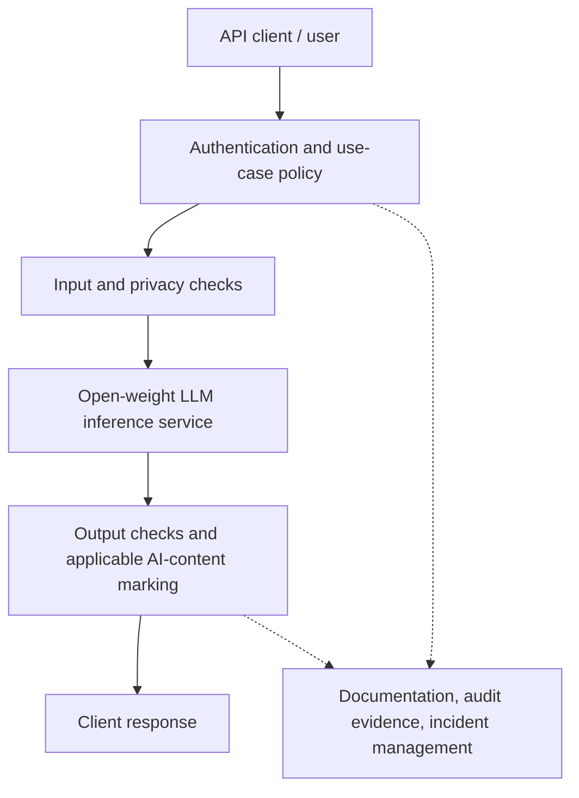

# EU AI Act: Four Risk Categories and LLM Deployment Examples

A practical, developer-oriented introduction to the **risk-based approach of the European Union Artificial Intelligence Act (AI Act)**, with examples of deploying an open-weight large language model (LLM) as an API or application.

> **Legal status:** This is an educational overview, not legal advice or a compliance certificate. It reflects **Regulation (EU) 2024/1689 as amended by Regulation (EU) 2026/1744** (reference date: **15 November 2026**). Check the consolidated legal text and applicable national/EU laws before launch.

## 1. Four commonly used AI risk categories

| Category | What it means | Typical application examples | Main implication | Legal reference |
| --- | --- | --- | --- | --- |
| **1. Unacceptable risk** | Certain AI practices are prohibited when they meet the statutory conditions. | Harmful manipulative AI; prohibited social scoring; untargeted facial-image scraping for face-recognition databases; prohibited workplace or school emotion recognition. | **Prohibited** (subject to precise definitions and exceptions). | Article 5 |
| **2. High risk** | AI systems within specified product-safety regimes or listed sensitive use cases. | AI screening and ranking job applicants; AI assessing admissions or learning outcomes; certain credit-scoring systems; AI safety components for critical infrastructure. | Strict **risk management, data governance, documentation, logging, human oversight, robustness and conformity** requirements where applicable. | Article 6, Annexes I and III, Articles 8–49 |
| **3. Transparency-related risk** | Certain AI interactions or synthetic outputs require disclosure or marking. | Customer-service chatbots; synthetic images/audio/video/text; deepfakes; some AI-generated public-interest text. | Inform people of AI interaction, mark synthetic outputs, or disclose AI-generated content **as applicable**. | Article 50 |
| **4. Other AI systems (minimal/no risk)** | Systems that do not fall under a prohibited/high-risk category and do not trigger a particular transparency rule. | Spam filtering; internal inventory prediction; internal technical document classification. | No general high-risk compliance regime solely because the system uses AI; other applicable duties and laws can still apply. | General framework of the Act |

**Important:** These are helpful explanatory categories, **not four mutually exclusive legal buckets**. A high-risk system can also have transparency duties. The classification depends chiefly on a **system's intended purpose and use**, not the name of its underlying model.

### 1.1 Unacceptable risk — examples

Article 5 prohibits specifically defined practices, including:

- Harmful AI-based manipulation or deception and exploitation of vulnerabilities, when the legal harm/distortion conditions are met.
- Social scoring that leads to defined unjustified or unrelated detrimental treatment.
- Certain individual crime-risk predictions based solely on profiling or personality traits.
- Untargeted scraping of facial images from the internet or CCTV to create or expand facial-recognition databases.
- Emotion recognition in workplaces and educational institutions, apart from prescribed exceptions.
- Certain sensitive biometric categorisation and real-time remote biometric identification practices.

The **2026 amendment** also introduces additional prohibitions concerning specified non-consensual intimate synthetic material and child sexual abuse material, applicable from **2 December 2026**. The legal conditions and exceptions must be read directly rather than treating every related text prompt as automatically prohibited.

**LLM example:** An application deliberately designed to exploit older users' vulnerabilities to induce financially harmful decisions may qualify as a prohibited practice. Merely providing a general-purpose chat API does *not* mean the model itself is automatically prohibited.

### 1.2 High risk — examples

Examples from **Annex III** include:

- **Recruitment:** LLM-based CV evaluation, candidate screening or ranking.
- **Education:** AI determining admission or assessing student learning outcomes.
- **Essential services:** Certain creditworthiness or insurance-related assessments.
- **Critical infrastructure:** Certain AI safety components used in operating electricity or water infrastructure.
- **Migration, law enforcement and justice:** Specific designated decision-support systems.

These examples are subject to the Act's exact scope, exceptions and classification rules. Not every AI tool used in a hospital, school or workplace is automatically high-risk.

### 1.3 Transparency-related risk — examples

- **Public-facing LLM chatbot:** Users should be informed that they are interacting with AI unless it is obvious or an applicable exception applies.
- **Generative AI system:** Applicable synthetic outputs require machine-readable marking that is technically effective and detectable.
- **Deepfake publisher:** Specified disclosures about generated/manipulated media may be required.

These are **different provider/deployer obligations**; a generic `ai_generated: true` field should not be assumed to satisfy all of Article 50.

### 1.4 Other AI systems — examples

- Internal technical-document tagging or search.
- Inventory forecasting.
- Spam classification.
- Coding assistance not embedded in a regulated high-risk application.

Such uses are often subject to fewer AI-Act-specific obligations, but **GDPR, intellectual-property, consumer, cybersecurity and other laws may still apply**.

## 2. The same LLM, four different deployments

Consider a single open-weight **Qwen** model:

| Deployment | Illustrative classification | Why |
| --- | --- | --- |
| An AI application intentionally manipulates vulnerable people into harmful financial choices | **Potentially unacceptable risk** | Its use may satisfy an Article 5 prohibition. |
| A platform uses the model to score and rank job applicants | **Generally high risk** | Recruitment screening is identified in Annex III, subject to Article 6 rules. |
| A public chatbot answers product-support questions | **Transparency obligations likely** | It interacts directly with people. |
| An internal API classifies non-sensitive engineering documents | **Often other/minimal risk** | Not inherently a listed high-risk use case, though specific obligations may still apply. |

**Principle:** `Risk classification = the AI system's intended purpose + functionality + deployment context + legal conditions`, not merely `model family` or `open-source licence`.

## 3. Additional, separate rules for General-Purpose AI (GPAI) models

**The system-risk categories above should not be confused with the separate GPAI model regime in Chapter V.**

| Layer | Relevant question | Main rules |
| --- | --- | --- |
| **Underlying GPAI model** | Do you develop/offer a general-purpose model? Does it have systemic risk? | Articles 51–55; technical documentation, training-content summary, copyright compliance, and additional systemic-risk duties where applicable. |
| **LLM-based AI system/service** | What does your chatbot/API/application do and who uses it? | Article 5 prohibitions; Article 50 transparency; high-risk rules when classified under Article 6. |

Under **Article 51**, training computation **greater than 10^25 FLOPs** creates a presumption of high-impact capabilities for systemic-risk classification; it is **not a universal safety-test threshold** or an automatic exemption below the threshold. Capabilities and impact can also matter.

Under **Article 55**, providers of **GPAI models with systemic risk** have additional obligations, including model evaluation, documented adversarial testing, systemic-risk mitigation, incident reporting and cybersecurity.

**Open-weight / open-source caveat:** Hosting an existing third-party model generally does not automatically make you its original GPAI model provider. But releasing code or weights under an open licence does **not** exempt every AI system or model from the Act. Qualifying free/open-source GPAI models have certain limited exemptions under Article 53, and those exceptions do not apply in the same way to systemic-risk GPAI models.

## 4. Deploying an LLM as an API: practical checklist

For an API serving an existing open-weight LLM (e.g., Qwen or Llama), assess the following before launch:

- [ ] **Role and responsibility:** Identify your role as AI-system provider, deployer, downstream provider, GPAI-model provider or a combination, as the legal definitions apply.
- [ ] **Intended use:** Document the audience, service capabilities, permitted uses and reasonably foreseeable misuse.
- [ ] **Prohibited-practice check:** Verify the service is not designed or operated for an Article 5 prohibited practice.
- [ ] **High-risk classification:** Check Article 6 and Annexes I/III; document any applicable exception and reasoning.
- [ ] **Transparency:** Assess chatbot disclosure, synthetic-content marking, and deepfake/public-interest disclosures under Article 50.
- [ ] **Privacy:** Determine GDPR roles, lawful basis, data minimisation, security, retention/deletion and applicable DPIA needs.
- [ ] **Security:** Protect authentication, API keys, model endpoints, system prompts, tools, private data and infrastructure.
- [ ] **Safety evaluation:** Assess jailbreaks, prompt injection, leakage, misuse and model limitations as proportionate engineering practice (and as a legal requirement when a relevant provision applies).
- [ ] **Documentation:** Keep model identity/version, licence, intended use, evaluation evidence, limitations, known risks and relevant policies.
- [ ] **Monitoring and incident response:** Establish proportionate operational monitoring and response; follow legally mandated reporting where applicable.
- [ ] **Human oversight:** Provide review and escalation controls proportionate to use; satisfy specific Article 14 requirements if the system is high-risk.
- [ ] **External dependencies:** Confirm upstream model licensing, provider information and responsibility-sharing arrangements.

**Do all ordinary chat APIs legally need red teaming?** **No universal mandatory red-teaming obligation** follows just from hosting an existing open-weight model as a general-purpose API. Requirements depend on your legal role, the AI system's use, and whether the GPAI systemic-risk or high-risk-system provisions apply. Basic safety testing is still prudent.

### Example service architecture

This gateway can **support** compliance but cannot substitute for required model-provider evidence, organisational governance, formal conformity assessments or compliance with data-protection law.

## 5. Key application dates (as amended in 2026)

| Date | Main event |
| --- | --- |
| **2 February 2025** | General provisions and original Article 5 prohibited-practice rules began applying. |
| **2 August 2025** | GPAI-model chapter began applying, subject to the Act's transition rules. |
| **2 August 2026** | General application date, including relevant Article 50 transparency rules. |
| **2 December 2026** | Newly introduced specified prohibitions apply; transitional Article 50(2) deadline for certain pre-existing systems. |
| **2 December 2027** | High-risk obligations for systems classified under Article 6(2)/Annex III. |
| **2 August 2028** | High-risk obligations for systems classified under Article 6(1)/Annex I. |

Other transition rules, exceptions and legal instruments may affect specific cases.

## 6. Official sources

1. [EU AI Act — consolidated text as of 27 July 2026 (EUR-Lex)](https://eur-lex.europa.eu/eli/reg/2024/1689/2026-07-27/eng)
2. [Regulation (EU) 2026/1744 — amending regulation (EUR-Lex)](https://eur-lex.europa.eu/legal-content/EN/TXT/?uri=CELEX:32026R1744)
3. [European Commission — AI Act risk-based approach](https://digital-strategy.ec.europa.eu/en/policies/regulatory-framework-ai)
4. [European Commission — AI Act Explorer](https://ai-act-service-desk.ec.europa.eu/en/ai-act-explorer)

---

**Takeaway:** The **same open-weight LLM** can underpin a prohibited system, a high-risk application, a transparency-regulated chatbot, or an ordinary low-risk tool. Always classify **the deployed use case** and assess **underlying GPAI-model obligations separately**.
